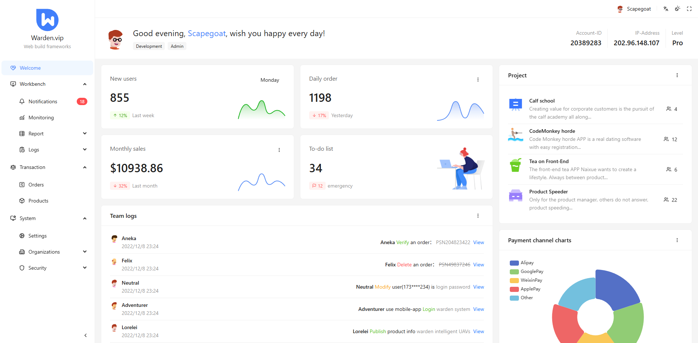

<div align="center"><a name="readme-top"></a>
  


<h1>adminui-antd-layout</h1>

这是一个基于Ant-design的布局组件

[English](./README.md) · 中文
### ❤️ 支持多种布局样式和自定义主题皮肤，支持多种路由且脱离UMI控制，细节控。



[演示👉](https://demo.adminui.dev)

</div>

## ✨ 特性

- 🌈 统一中后台交互体验和风格。
- 📦 开箱即用集成丰富的模版。
- ⚙️ 配套细节控制组件可插拔。
- 🌍 支持国际化。
- 🎨 支持更深度的主题定制。

## 📦 安装

```bash
npm install @adminui-dev/antd-layout --save
```

```bash
yarn add @adminui-dev/antd-layout
```

```bash
pnpm add @adminui-dev/antd-layout
```

```bash
bun add @adminui-dev/antd-layout
```
## 📦 安装依赖
```json
"@ant-design/colors": "^7.2.1",
"antd": "^6.1.1",
"dayjs": "^1.11.19",
"nprogress": "^0.2.0",
"react": "^19.2.0",
"react-dom": "^19.2.0",
"react-intl": "^8.0.4",
"react-router": "^7.11.0",
"react-router-dom": "^7.11.0"
```

## 🚀 或者使用 npx create-antd-layout 快速模版构建（推荐）
```bash
npx create-antd-layout@latest your-app
```
## 🔨 示例
### 1. 配置路由
```jsx
// src/routes.ts

import { LazyPage } from "@adminui-dev/antd-layout";
import { createBrowserRouter,redirect } from "react-router-dom";

const DashboardLayout = LazyPage(()=>import("@/layouts"))
const LoginPage = LazyPage(()=>import("@/pages/login"))
const OrderPage = LazyPage(()=>import("@/pages/transaction/order"))
const ProductPage = LazyPage(()=>import("@/pages/transaction/product"))
const WelcomePage = LazyPage(()=>import("@/pages/welcome"))
const ConfigPage = LazyPage(()=>import("@/pages/system/config"))
const LogsPage = LazyPage(()=>import("@/pages/system/logsPage"))
const NotFound = LazyPage(()=>import("@/pages/404"))
/**
 * global router data
 * standard react-router solution
 * reference: https://reactrouter.com/start/data/routing
 *  
 */
const routers = createBrowserRouter(
    [
       { path:"/", Component:DashboardLayout, children: [
        { index:true, loader:()=>redirect("/welcome") },    
        { path:"welcome", Component:WelcomePage},
        { path:"transaction", children: [
            { index:true, loader:()=>redirect("/transaction/order") },
            { path:"order",Component:OrderPage },
            { path:"product",Component:ProductPage }
        ]},
         { path:"system", children:[
            { index:true,loader:()=>redirect("/system/config")},
            { path:"config",Component:ConfigPage },
            { path:"logs",Component:LogsPage }
        ]},        
        { path:"/login",Component:LoginPage },      
       ]},       
       { path:"*",Component:NotFound }
    ]
)

export { routers }

// src/App.tsx
import { Suspense } from 'react';
import 'nprogress/nprogress.css'; 
import { PageLoading } from '@adminui-dev/antd-layout'
import { RouterProvider } from 'react-router'
import { routers } from './routes'

function App() {  
  return (
    <>
      <Suspense fallback={<PageLoading />}>
        <RouterProvider router={routers} />
      </Suspense>
    </>
  )
}

export default App
```

### 2. 配置布局文件和菜单
```tsx
// src/layouts/index.tsx

import { AntdLayout } from "@adminui-dev/antd-layout"
import type { LayoutConfig,MenuData } from "@adminui-dev/antd-layout"

/**
* menu data
*/
const menuData:MenuData = {
    name:"",
    path:"/",
    label:"Dashboard",
    children:[
        {name:"welcome",path:"welcome",label:"Welcome"},
        {name:"transaction",path:"transaction",label:"Transaction",children:[
            {name:"order",path:"order",label:"Order"},
            {name:"product",path:"product",label:"Product"},
        ]},
        {name:"system",path:"system",label:"System",children:[
            {name:"config",path:"config",label:"Config"},
            {name:"logs",path:"logs",label:"Logs"},
        ]},
    ]
}

/**
* dashboard layout
*/
const MainLayout = () => {
  // layout config
  const layoutConfig:LayoutConfig = {
      disabledLocale:true,
      layoutType:"leftMenu"  
  }
  return(
  <>
    <AntdLayout layoutConfig={layoutConfig} menuData={menuData} />
  </>
  )
}
export default MainLayout;
```
可参考🍸[https://github.com/zhouwenqi/adminui-demo-antd-layout-simple](https://github.com/zhouwenqi/adminui-demo-antd-layout-simple)

## ✅ 更多配置请参考官方文档
官网🔗[https://adminui.dev](https://adminui.dev/zh)

文档🔗[https://adminui.dev/zh/docs](https://adminui.dev/zh/docs)
